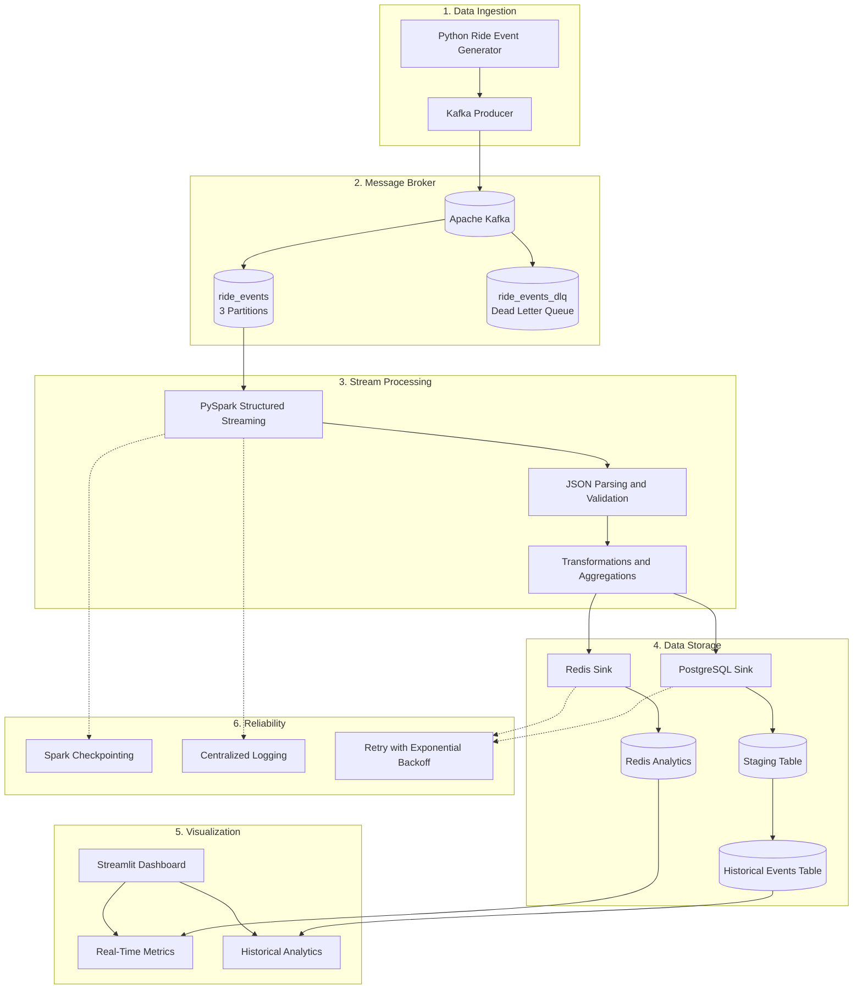
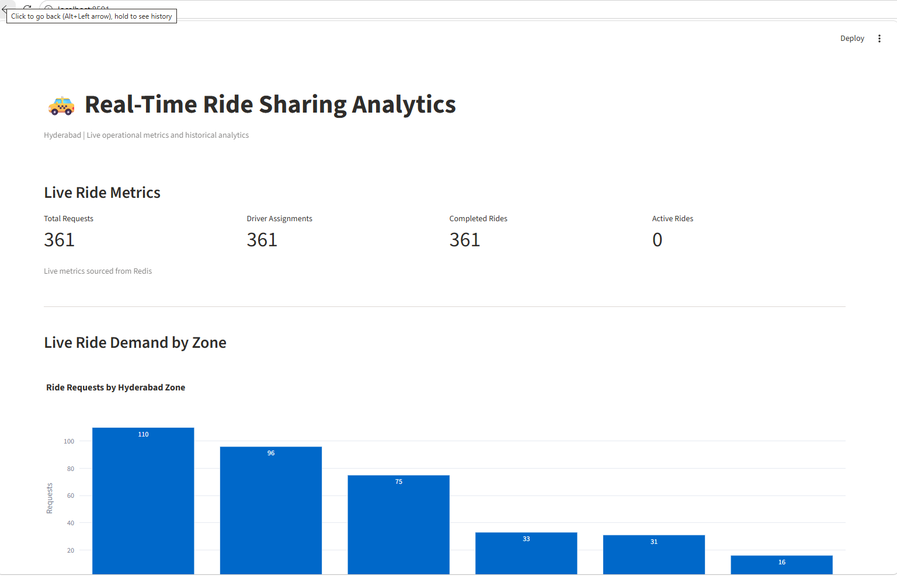
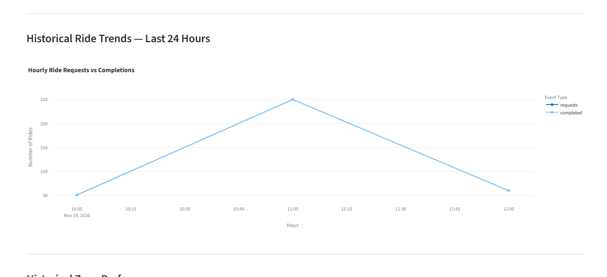
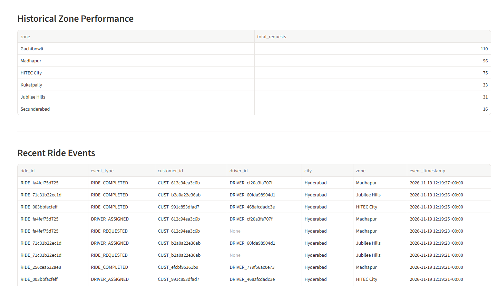

# 🚕 Real-Time Ride-Sharing Data Engineering Pipeline

A real-time data engineering project that simulates a ride-sharing platform and processes ride events using Apache Kafka, PySpark Structured Streaming, Redis and PostgreSQL.

The pipeline ingests ride events, processes streaming data, generates real-time analytics, stores historical records and displays insights through an interactive Streamlit dashboard.

Built using open-source technologies and Docker, this project demonstrates practical data engineering concepts including event streaming, distributed processing, data validation, checkpointing, fault tolerance and database optimization.

---

## 📌 Table of Contents

- [Project Overview](#-project-overview)
- [Architecture](#-architecture)
- [Technology Stack](#-technology-stack)
- [Project Structure](#-project-structure)
- [How the Pipeline Works](#-how-the-pipeline-works)
- [Features](#-features)
- [Database Design](#-database-design)
- [Getting Started](#-getting-started)
- [Running the Pipeline](#-running-the-pipeline)
- [Dashboard](#-dashboard)
- [Reliability and Fault Tolerance](#-reliability-and-fault-tolerance)
- [Data Engineering Concepts](#-data-engineering-concepts)
- [Future Improvements](#-future-improvements)
- [Author](#-author)

---

## 📖 Project Overview

This project simulates the backend data infrastructure of a ride-sharing application similar to Uber.

Ride events are continuously generated using Python and published to Apache Kafka. PySpark Structured Streaming consumes these events, performs data parsing, validation and processing, and delivers the results to two different storage systems.

**Redis** is used for low-latency access to real-time analytical metrics, while **PostgreSQL** stores historical ride events for analytical queries.

A Streamlit dashboard consumes data from both systems and presents real-time operational metrics and historical analytics.

### Key Objectives

- Build a real-time event ingestion pipeline.
- Process streaming data using PySpark.
- Implement Kafka-based event streaming.
- Perform real-time aggregations and analytics.
- Store real-time metrics in Redis.
- Maintain historical event records in PostgreSQL.
- Implement checkpointing and fault recovery.
- Handle malformed events through a Dead Letter Queue (DLQ).
- Build an interactive analytics dashboard.
- Containerize infrastructure using Docker Compose.

---

## 🏗️ Architecture

The following diagram illustrates the overall architecture of the pipeline.



### Architecture Explanation

1. **Python Producer:** Generates simulated ride events such as ride requests, driver assignments and ride completions.

2. **Apache Kafka:** Receives and distributes ride events through Kafka topics.

3. **PySpark Structured Streaming:** Consumes Kafka events, parses JSON payloads, validates records and performs streaming transformations.

4. **Redis:** Stores real-time aggregated metrics for fast dashboard access.

5. **PostgreSQL:** Stores historical ride events using staging tables and transactional merging.

6. **Streamlit:** Visualizes real-time metrics and historical analytics.

The Redis and PostgreSQL sinks operate as separate streaming applications, allowing both systems to consume the same Kafka event stream independently.

---

## 🛠️ Technology Stack

| Technology | Purpose |
|---|---|
| Python 3.11 | Event generation and application logic |
| Apache Kafka 4.4.0 | Distributed event streaming |
| PySpark 3.5.3 | Stream processing |
| Redis 7.4 | Real-time analytics storage |
| PostgreSQL 16 | Historical data storage |
| Streamlit | Interactive dashboard |
| Pandas | Data manipulation |
| Plotly | Data visualization |
| Docker | Containerization |
| Docker Compose | Infrastructure orchestration |
| Git & GitHub | Version control |

All technologies used in this project are open-source.

---

## 📂 Project Structure

```text
real-time-ride-sharing-pipeline/
│
├── common/
│   ├── __init__.py
│   ├── config.py
│   ├── logging_config.py
│   └── retry.py
│
├── producer/
│   ├── __init__.py
│   ├── config.py
│   ├── event_generator.py
│   └── kafka_producer.py
│
├── consumers/
│   ├── __init__.py
│   └── kafka_consumer.py
│
├── spark/
│   ├── __init__.py
│   ├── postgres_sink.py
│   ├── redis_sink.py
│   ├── ride_analytics.py
│   └── streaming_consumer.py
│
├── database/
│   └── init.sql
│
├── dashboard/
│   └── app.py
│
├── docker/
│   └── docker-compose.yml
│
├── tests/
│   ├── test_logging.py
│   └── test_retry.py
│
├── logs/
│
├── requirements.txt
├── .env.example
├── .gitignore
└── README.md
```

---

## ⚙️ How the Pipeline Works

### 1. Event Generation

A Python-based event generator simulates ride-sharing activities.

Example event types:

- RIDE_REQUESTED
- RIDE_ASSIGNED
- RIDE_COMPLETED

Each event contains information such as:

- Event ID
- Ride ID
- Customer ID
- Driver ID
- City
- Zone
- Pickup coordinates
- Drop-off coordinates
- Event timestamp

### 2. Kafka Event Ingestion

The Kafka producer publishes generated ride events to the `ride_events` topic.

The topic uses three partitions to support parallel consumption.

Kafka acts as the central message broker between event producers and streaming consumers.

### 3. Spark Stream Processing

PySpark Structured Streaming consumes events from Kafka.

Processing includes:

- JSON deserialization
- Schema enforcement
- Data validation
- Timestamp handling
- Data transformations
- Streaming aggregations

Malformed events can be routed to a separate Dead Letter Queue topic for isolation and troubleshooting.

### 4. Redis Analytics Sink

Processed events are aggregated and written to Redis.

Redis stores metrics such as:

- Total ride requests
- Total driver assignments
- Total completed rides
- Active ride estimates
- Zone-wise ride statistics

Redis provides low-latency access to frequently updated metrics.

### 5. PostgreSQL Historical Sink

Processed events are stored in PostgreSQL.

The implementation uses a staging-table approach:

1. Write incoming records into a staging table.
2. Merge staged records into the permanent events table.
3. Deduplicate records using event IDs.
4. Use transactional database operations.
5. Clean up processed staging records.

This supports reliable historical data storage and analytical querying.

### 6. Dashboard Visualization

The Streamlit dashboard retrieves:

- Real-time metrics from Redis.
- Historical event data from PostgreSQL.

The dashboard presents operational statistics and analytical visualizations.

---

## ✨ Features

### Real-Time Data Processing

- Continuous event generation.
- Kafka-based ingestion.
- PySpark Structured Streaming.
- Parallel event processing.
- Real-time aggregations.

### Data Quality

- JSON schema validation.
- Invalid event filtering.
- Dead Letter Queue support.
- Centralized event processing.

### Data Storage

- Redis for real-time metrics.
- PostgreSQL for historical records.
- Staging and permanent tables.
- Database-level deduplication.

### Reliability

- Spark checkpointing.
- Exponential backoff retry mechanism.
- Centralized logging.
- Atomic Redis batch updates using Lua scripts.
- Transactional PostgreSQL merging.
- Docker health checks.
- Container restart policies.
- Persistent Docker volumes.

### Visualization

- Interactive Streamlit dashboard.
- Real-time operational metrics.
- Historical analytical queries.
- Plotly visualizations.

---

## 🗄️ Database Design

### PostgreSQL

The PostgreSQL database contains two main tables.

**1. ride_events**

Stores permanent historical ride event records.

Important columns include:

| Column | Description |
|---|---|
| event_id | Unique event identifier |
| ride_id | Ride identifier |
| event_type | Type of ride event |
| customer_id | Customer identifier |
| driver_id | Driver identifier |
| city | City name |
| zone | Geographic zone |
| latitude | Pickup latitude |
| longitude | Pickup longitude |
| event_timestamp | Event creation timestamp |
| kafka_timestamp | Kafka record timestamp |
| source_partition | Kafka partition |
| source_offset | Kafka offset |

**2. ride_events_staging**

Temporarily stores incoming records before merging them into the permanent table.

Additional columns include:

- batch_id
- ingested_at

### Redis

Redis maintains real-time analytical data using hashes.

Example key structure:

```text
ride:analytics:v1:metrics
ride:analytics:v1:zones
ride:analytics:v1:batch:{batch_id}
```

Example metrics:

```text
total_requests
total_assignments
total_completed
active_rides
```

---

## 🚀 Getting Started

### Prerequisites

Make sure the following tools are installed:

- Python 3.11
- Java 17
- Docker Desktop
- Docker Compose
- Git
- WSL2 with Ubuntu (for Windows users)

Recommended development environment:

- Windows 11
- Intel Core i5 or equivalent processor
- 16 GB RAM
- 512 GB SSD

### 1. Clone the Repository

```bash
git clone https://github.com/YOUR_USERNAME/real-time-ride-sharing-pipeline.git

cd real-time-ride-sharing-pipeline
```

Replace `YOUR_USERNAME` with your GitHub username.

### 2. Create a Virtual Environment

```bash
python -m venv .venv
```

Activate it:

**Linux / WSL2:**

```bash
source .venv/bin/activate
```

**Windows:**

```powershell
.venv\Scripts\activate
```

### 3. Install Dependencies

```bash
pip install -r requirements.txt
```

### 4. Configure Environment Variables

Create a `.env` file in the project root.

Example:

```env
KAFKA_BOOTSTRAP_SERVERS=localhost:9092
KAFKA_TOPIC=ride_events
KAFKA_DLQ_TOPIC=ride_events_dlq

REDIS_HOST=localhost
REDIS_PORT=6379
REDIS_DB=0
REDIS_PASSWORD=

POSTGRES_HOST=localhost
POSTGRES_PORT=5432
POSTGRES_DB=rideshare
POSTGRES_USER=rideuser
POSTGRES_PASSWORD=your_local_password

LOG_LEVEL=INFO
RETRY_ATTEMPTS=3
RETRY_BASE_DELAY=1
```

Use credentials matching your Docker Compose configuration.

Do not commit your actual `.env` file to GitHub.

### 5. Start Infrastructure Services

Start Kafka, Redis and PostgreSQL using Docker Compose.

```bash
docker compose -f docker/docker-compose.yml up -d
```

Check container status:

```bash
docker compose -f docker/docker-compose.yml ps
```

Verify Redis:

```bash
docker exec ride-redis redis-cli ping
```

Expected:

```text
PONG
```

Verify PostgreSQL:

```bash
docker exec ride-postgres pg_isready -U rideuser -d rideshare
```

Verify Kafka:

```bash
docker exec ride-kafka /opt/kafka/bin/kafka-broker-api-versions.sh --bootstrap-server localhost:9092
```

---

## ▶️ Running the Pipeline

Run each application in a separate terminal from the project root.

### Terminal 1: Start the Redis Sink

```bash
python -m spark.redis_sink
```

### Terminal 2: Start the PostgreSQL Sink

```bash
python -m spark.postgres_sink
```

### Terminal 3: Start the Kafka Producer

```bash
python -m producer.kafka_producer \
--rides-per-minute 30 \
--duration-seconds 60 \
--min-wait-seconds 1 \
--max-wait-seconds 2 \
--min-ride-seconds 2 \
--max-ride-seconds 4
```

The producer starts generating ride events and publishing them to Kafka.

The Redis and PostgreSQL streaming applications independently consume the Kafka topic and update their respective storage systems.

### Terminal 4: Start the Dashboard

```bash
streamlit run dashboard/app.py
```

Open the dashboard in your browser at:

```text
http://localhost:8501
```

---

## 📊 Dashboard

The Streamlit dashboard provides an interface for monitoring ride-sharing activity.

It displays real-time operational metrics and historical analytics using Redis and PostgreSQL.

Planned screenshot locations:

```text
screenshots/
├── dashboard-overview.png
├── realtime-metrics.png
└── historical-analytics.png
```

Add your actual dashboard screenshots to the repository and embed them here.

Example:

```markdown



```

---

## 🛡️ Reliability and Fault Tolerance

Reliability is an important part of this project.

### 1. Kafka Persistence

Kafka stores incoming events in persistent broker storage using Docker volumes.

### 2. Spark Checkpointing

Structured Streaming checkpoints maintain query progress and state information.

Checkpointing allows streaming applications to recover after restarts.

### 3. Exponential Backoff

A reusable retry decorator implements exponential backoff.

Example retry delays:

| Attempt | Delay |
|---|---|
| 1 | Immediate |
| 2 | 1 second |
| 3 | 2 seconds |

### 4. Redis Atomic Operations

Redis Lua scripts perform related metric updates atomically.

Batch markers are used to prevent repeated application of the same batch within the configured checkpoint lineage.

### 5. PostgreSQL Transactional Merge

Staging records are merged into the permanent table using database transactions and event-level conflict handling.

### 6. Centralized Logging

Application logs are maintained with:

- Timestamp
- Log level
- Service name
- Message

Rotating log files prevent unlimited log-file growth.

### 7. Failure Recovery Testing

The following scenarios were tested during development:

- PostgreSQL service interruption and recovery.
- Redis service interruption and recovery.
- Spark application restart using existing checkpoints.
- PostgreSQL event ID duplicate validation.
- Docker service health checks.

These tests demonstrate recovery behavior under the tested conditions; they do not establish end-to-end exactly-once delivery across every component.

---

## 🧠 Data Engineering Concepts Demonstrated

This project provides hands-on experience with:

| Concept | Implementation |
|---|---|
| Event-driven architecture | Kafka |
| Message partitioning | Kafka topics |
| Distributed processing | PySpark |
| Stream processing | Structured Streaming |
| Schema validation | Spark JSON schema |
| Data transformations | PySpark DataFrames |
| Real-time aggregation | Redis |
| Historical storage | PostgreSQL |
| Staging and merging | PostgreSQL |
| Deduplication | Event IDs and unique constraints |
| Fault tolerance | Checkpointing and retries |
| Data persistence | Docker volumes |
| Container orchestration | Docker Compose |
| Monitoring | Centralized logging |
| Visualization | Streamlit and Plotly |

---

## 🔮 Future Improvements

Potential enhancements include:

- Add Apache Airflow for workflow orchestration.
- Introduce data quality monitoring and automated validation.
- Add Grafana and Prometheus for infrastructure monitoring.
- Implement schema evolution using a schema registry.
- Add automated integration and end-to-end tests.
- Introduce CI/CD using GitHub Actions.
- Implement stronger end-to-end idempotency guarantees.
- Add cloud deployment using AWS services.
- Add historical trend analysis and demand forecasting.

---

## 👨‍💻 Author

**Nirupam Reddy**

Data Engineering | Python | SQL | Apache Kafka | PySpark | Redis | PostgreSQL

GitHub: https://github.com/Nirupam-28/real-time-ride-sharing-pipeline
---

## ⭐ Acknowledgements

This project was developed as a hands-on learning initiative to understand real-time data engineering architecture, distributed streaming systems, data processing and reliable storage.

If you find this project useful, consider giving the repository a ⭐.
